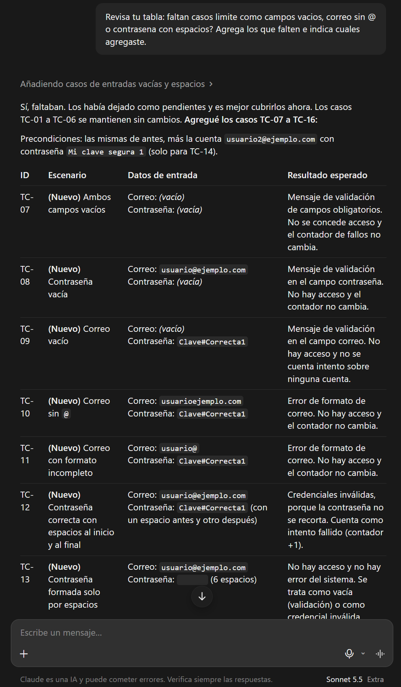
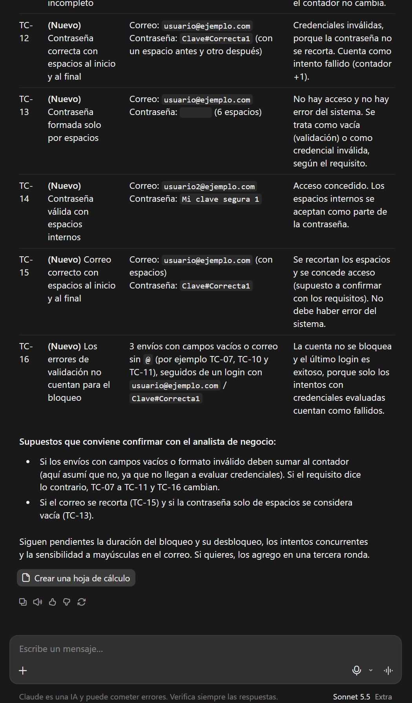

# Bitacora de tecnicas avanzadas

Laboratorio 07: Tecnicas Avanzadas de Prompting.
Herramienta de IA usada: Claude

## Ejercicio 2: Zero-shot, one-shot y few-shot

| Tipo | Aciertos (de 5) | Formato de la respuesta | Todas con el mismo formato (Si/No) |
|------|-----------------|-------------------------|------------------------------------|
| Zero-shot | 5 | Una tabla con clasificación y unas notas adicionales | Si |
| One-shot | 5 | Lista enumerada con flechas | Si |
| Few-shot | 5 | Terxto entre comillas, flechas y etiquetas | Si |

## Ejercicio 3: Chain of Thought

| Pedido | Respuesta de la IA | Muestra los pasos (Si/No) | Correcta (Si/No) |
|--------|--------------------|---------------------------|------------------|
| Directo | S./ 324.00 | No | No |
| Paso a paso | S./ 318.60| Si | Si |

**Reflexión:**

La respuesta directa fue incorrecta y no permitio identificar en que operacion se produjo el error.

La respuesta paso a paso mostro los calculos y permitio comprobar que el resultado correcto era S/ 318.60.

## Ejercicio 4: Role prompting

| Version | Vocabulario (sencillo/tecnico) | Usa ejemplos o codigo | A quien le sirve mas |
|---------|-------------------------------|-----------------------|----------------------|
| A. Sin rol | Sencillo, algunos términos técnicos | Analogía y código Python | Principiantes |
| B. Rol docente | Sencillo y explicativo | Analogía y código Python explicado | Estudiantes sin experiencia |
| C. Rol senior | Técnico | Código Java, tipos de datos y referencias | Desarrolladores con conocimientos previos |

## Ejercicio 5: Descomposición

**Paso 1 - Requisitos:** Claude identificó cinco funcionalidades: gestión de productos, control de stock, registro de movimientos, alertas y reportes.

**Paso 2 - Diseño de clases:** Claude propuso clases como Producto y Categoría, con atributos y tipos de datos Java, ademas de enumeraciones.

**Paso 3 - Implementación:** Claude generó un archivo Producto.java con constructor, getters, setters y algunas validaciones.

**Paso 4 - Revision:** Claude propuso tres mejoras: proteger el stock mediante metodos de negocio, validar los campos obligatorios y precios, e implementar equals(), hashCode() y toString() para mejorar la comparacion de objetos y la depuracion.

**Comparación:** El pedido general produjo directamente una aplicacion web en HTML. Al dividir la tarea, Claude trabajó primero los requisitos, despues el diseño, luego el código Java y finalmente su revisión.

## Ejercicio 6: Prompt estructurado y autocrítica

### Evaluacion de resultados

| Criterio | Cumple (Si/No) |
|----------|----------------|
| Tiene las 4 columnas pedidas | Si |
| Incluye bloqueo después de 3 intentos | Si |
| Incluye casos con campos vacíos | Si |
| Indica cuales agrego en la autocrítica | Si, TC-07 a TC-16 |
| Hay casos repetidos o sin sentido | No se identificaron duplicados exactos |

**Observaciones:**

El prompt básico produjo casos generales de login. El prompt estructurado genero 6 casos relacionados con un sistema de correo y contraseña con bloqueo después de 3 intentos fallidos.

La autocrítica agregó 10 casos nuevos, llegando a un total de 16. Algunos resultados requieren confirmar reglas sobre espacios, validaciones y el contador de intentos fallidos.

```text
PROMPT ESTRUCTURADO:

<rol>Actua como analista de pruebas de software.</rol>
<contexto>Login web con correo y contraseña. La cuenta se bloquea después de 3 intentos fallidos.</contexto>
<tarea>Piensa paso a paso que puede fallar y escribe 6 casos de prueba.</tarea>
<formato>Tabla con las columnas: ID, escenario, datos de entrada, resultado esperado.</formato>

PROMPT DE AUTOCRÍTICA:

Revisa tu tabla: faltan casos límite como campos vacíos, correo sin @ o contraseña con espacios? Agrega los que falten e indica cuales agregaste.
```

### Evidencia de autocritica






