# Tarea: Mi prompt avanzado

## Tarea elegida

Detectar y corregir errores en una clase Java Producto.

## Version 1: prompt basico
### Prompt utilizado

Revisa este codigo Java y corrige los errores.

### Codigo Java utilizado

```java
public class Producto {
    private String nombre;
    private double precio;
    private int stock;

    public Producto(String nombre, double precio, int stock) {
        nombre = nombre;
        precio = precio;
        stock = stock;
    }

    public void setPrecio(double precio) {
        this.precio = precio;
    }

    public void vender(int cantidad) {
        stock = stock - cantidad;
    }

    public void mostrarProducto() {
        System.out.println(nombre + " - S/ " + precio + " - Stock: " + stock);
    }
}
```

### Evidencia de la Version 1


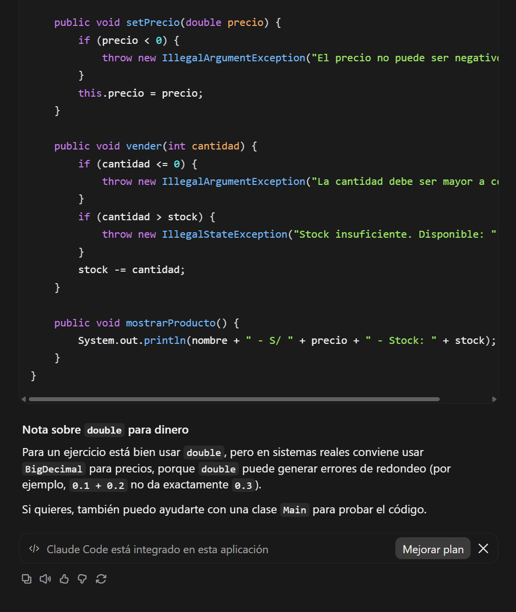

### Resultado de Claude

Claude identifico cuatro problemas principales:

1. El constructor asignaba los parametros a si mismos en lugar de inicializar los atributos.
2. El metodo vender no validaba cantidades negativas, cero o superiores al stock disponible.
3. El metodo setPrecio permitia precios negativos.
4. El constructor no validaba datos como nombre vacio, precio negativo o stock negativo.

Tambien propuso agregar getters como mejora opcional.

### Observaciones

Claude detecto los problemas principales y genero una version corregida de la clase Producto. Aunque el prompt era basico, presento una lista de errores y explicaciones.

No se solicito un formato especifico ni una comprobacion de compilacion. El codigo corregido todavia no ha sido probado mediante ejecucion.

## Version 2

### Prompt utilizado

**Tecnicas incorporadas:** Role prompting y formato estructurado.

Actua como un revisor de codigo Java senior.

Revisa la siguiente clase Producto e identifica errores de logica, validacion y encapsulacion.

Presenta el diagnostico en una tabla con estas columnas:
1. Ubicacion del problema
2. Error identificado
3. Explicacion
4. Correccion propuesta

Despues de la tabla, escribe el codigo Java completo y corregido.

Codigo a revisar:

**Codigo utilizado:** La misma clase Producto de la
Version 1, sin modificar sus errores intencionales.
### Resultado de Claude

Claude presentó un diagnóstico en tabla con 9 hallazgos. Identificó los problemas principales del constructor, las validaciones de precio y stock, y propuso mejoras adicionales de encapsulación y diseño.

La respuesta incluyó la ubicación de cada problema, su explicación y la corrección propuesta. Tambien generó una clase Producto corregida.

### Observaciones

En comparación con V1, la respuesta de V2 fue mas estructurada y fácil de revisar. El rol de revisor Java senior y el formato solicitado permitieron relacionar cada problema con su causa y solución.

No todos los hallazgos representan errores obligatorios. Algunas propuestas, como utilizar final o rechazar precios iguales a cero, dependen de las reglas del negocio.

El código corregido aun no ha sido compilado ni ejecutado.


### Evidencias de la Version 2

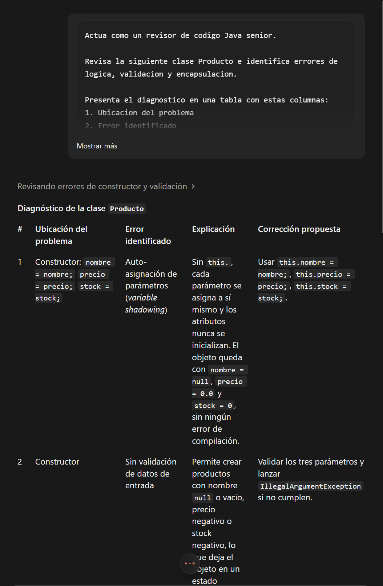

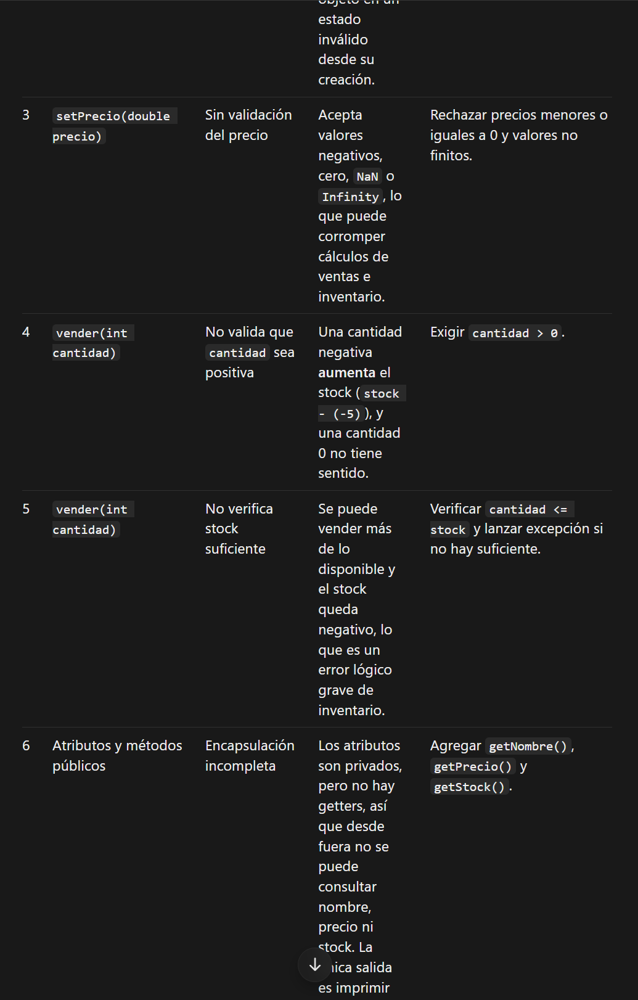

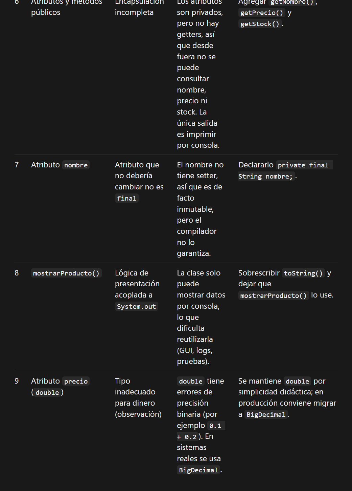

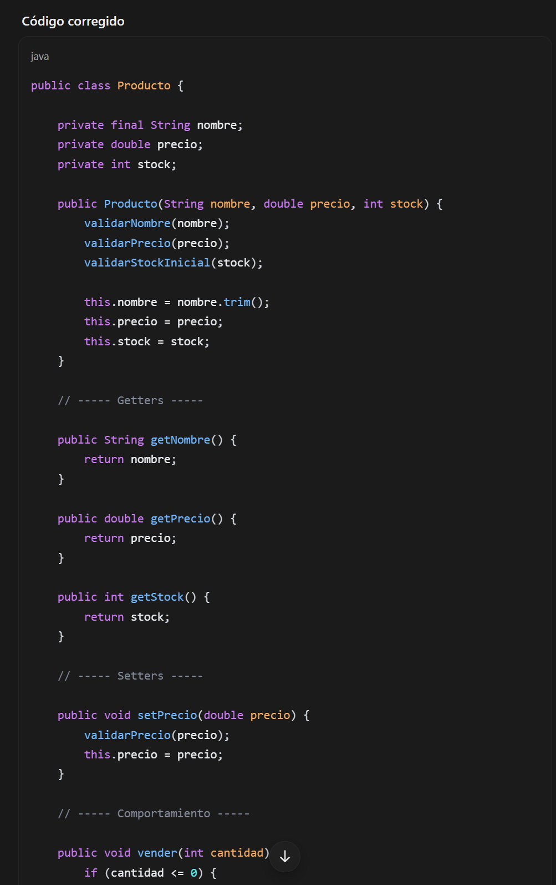

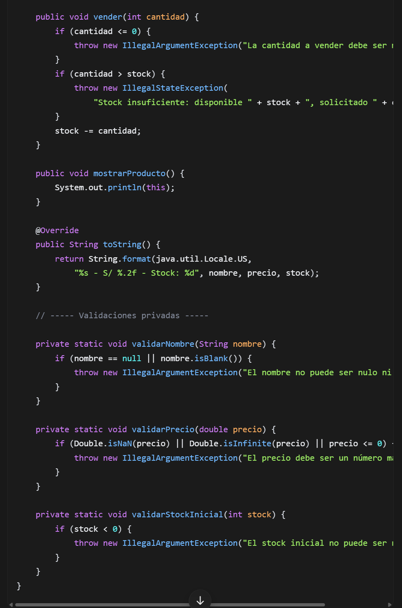

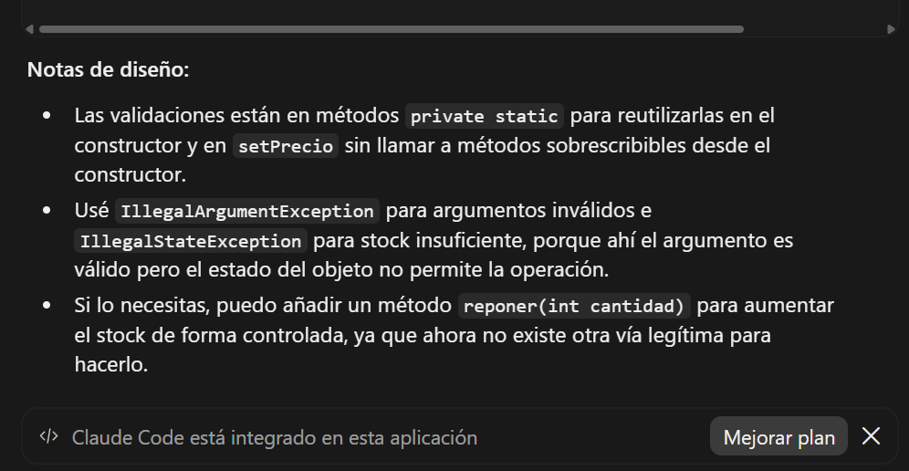

## Version 3: prompt final

### Prompt utilizado

```
<rol>
Actua como revisor de codigo Java senior, especializado en programacion orientada a objetos, validaciones y buenas practicas.
</rol>

<contexto>
Estamos revisando una clase Producto de un sistema de inventario.
El codigo contiene errores intencionales. Debes distinguir errores reales de mejoras opcionales de diseno.
</contexto>

<tarea>
1. Identifica los errores de logica y validacion.
2. Explica que instruccion provoca cada problema y por que.
3. Propone una correccion concreta.
4. Escribe la clase Producto completa y corregida.
5. Propone casos de prueba para verificar las correcciones.
</tarea>

<ejemplo>
Ubicacion: metodo vender(int cantidad).
Problema: no valida una cantidad igual a cero.
Consecuencia: se acepta una operacion sin sentido para el inventario.
Correccion: verificar que cantidad sea mayor que cero antes de modificar el stock.
Clasificacion: error de validacion.
</ejemplo>

<ejemplo>
Ubicacion: constructor.
Problema: no valida un precio negativo.
Consecuencia: permite crear productos con datos invalidos.
Correccion: rechazar precios negativos mediante una validacion.
Clasificacion: error de validacion.
</ejemplo>

<reglas>
- Conserva los nombres de la clase y sus metodos originales.
- Distingue errores reales de mejoras opcionales.
- No inventes resultados de compilacion o ejecucion.
- Justifica las reglas de negocio que asumas.
- No cambies el codigo original antes de evaluarlo.
</reglas>

<formato>
Primero presenta una tabla con:
ID | Ubicacion | Problema | Consecuencia | Correccion | Clasificacion

Despues escribe:
1. Codigo Java corregido.
2. Casos de prueba con entradas y resultados esperados.
3. Mejoras opcionales separadas de los errores.
4. Revision final: posibles omisiones y limitaciones de tu propuesta.
</formato>

<codigo_java>
public class Producto {
    private String nombre;
    private double precio;
    private int stock;

    public Producto(String nombre, double precio, int stock) {
        nombre = nombre;
        precio = precio;
        stock = stock;
    }

    public void setPrecio(double precio) {
        this.precio = precio;
    }

    public void vender(int cantidad) {
        stock = stock - cantidad;
    }

    public void mostrarProducto() {
        System.out.println(nombre + " - S/ " + precio + " - Stock: " + stock);
    }
}
</codigo_java>
```

En esta versión se aplicó un prompt avanzado con un rol
profesional, instrucciones estructuradas, ejemplos de
diagnóstico y una solicitud de revisión final.

El codigo evaluado fue el mismo de las versiones 1 y 2,
sin modificar los errores intencionales.

### Resultado de Claude

Claude identificó 7 problemas de lógica y validación (E1 a E7) en la clase Producto.

Presentó un diagnóstico con las columnas ID, ubicación, problema, consecuencia, corrección y clasificación.

Generó una versión corregida de la clase, propuso 18 casos de prueba (T1 a T18) y separó las mejoras opcionales de los errores reales.

Finalmente, realizó una revisión de su propuesta e identificó limitaciones relacionadas con las reglas de negocio, concurrencia, límites numéricos y ausencia de pruebas ejecutadas.

### Observaciones

La V3 proporcionó una respuesta mas controlada y verificable. Aunque V2 había reportado 9 hallazgos, V3 distinguió 7 problemas del codigo de las recomendaciones opcionales.

Los 18 casos de prueba incluyen entradas, resultados esperados y situaciones límite. Sin embargo, Claude no compiló ni ejecutó el código, por lo que los resultados todavía requieren comprobación práctica.

### Evidencias de la Version 3

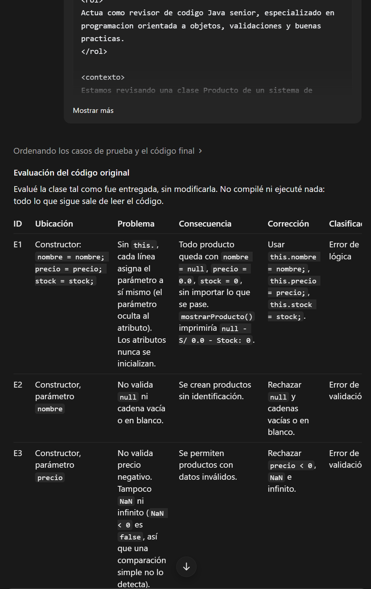

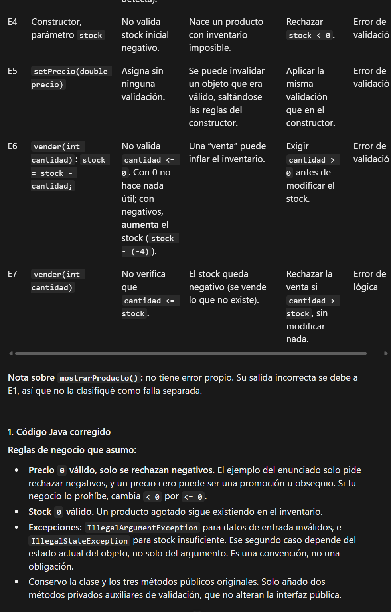

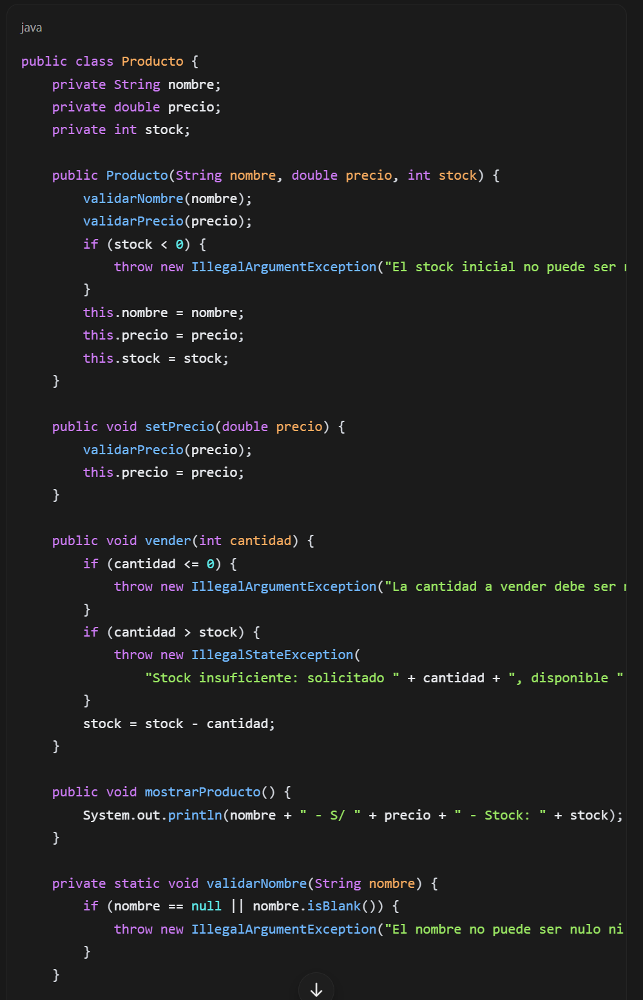

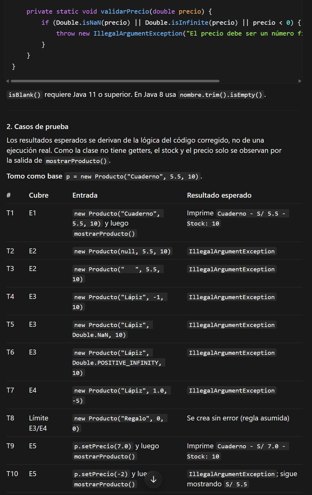

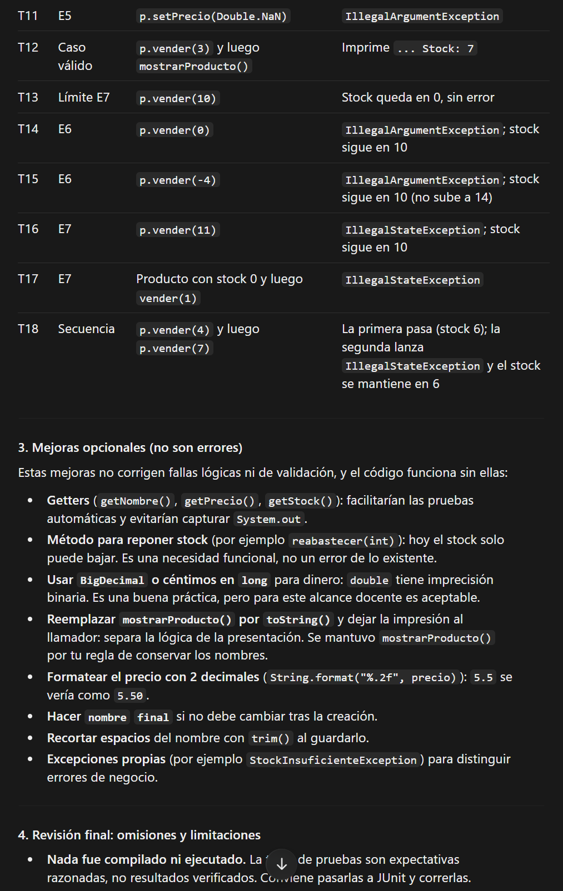

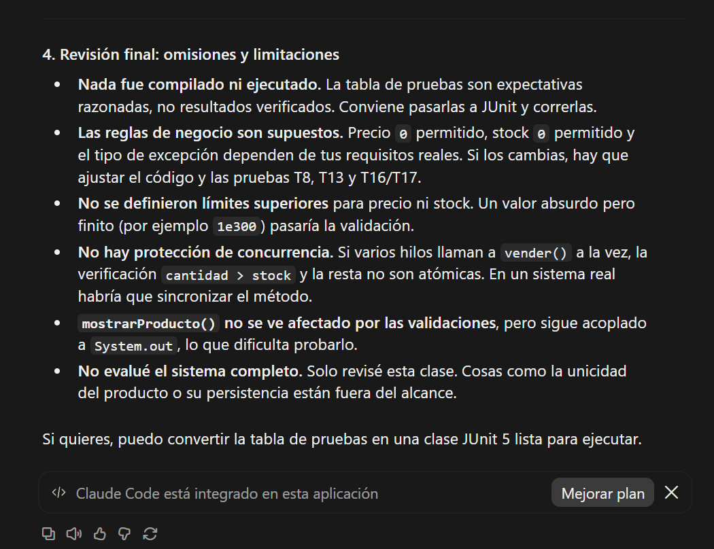

## Tecnicas usadas en el prompt final


| Tecnica | Aplicacion en V3 | Objetivo |
|---|---|---|
| Role prompting | Revisor de codigo Java senior | Orientar el analisis tecnico |
| Prompt estructurado | Etiquetas rol, contexto, tarea, reglas y formato | Organizar las instrucciones |
| Few-shot | Dos ejemplos de diagnostico | Mostrar el patron de respuesta |
| Autocritica | Revision final de omisiones y limitaciones | Evaluar la propia propuesta |

## Evaluacion del resultado

| Criterio | Cumple (Si/No) |
|---|---|
| Identifica los principales errores del codigo | Si |
| Presenta una tabla con las 6 columnas solicitadas | Si |
| Distingue errores reales de mejoras opcionales | Si |
| Genera codigo Java corregido | Si |
| Propone casos de prueba | Si |
| Realiza revision final de limitaciones | Si |
| Compila y ejecuta el codigo | No |

## ¿Por que elegi estas tecnicas?

Elegi estas tecnicas porque permiten obtener respuestas mas organizadas, precisas y faciles de verificar al revisar codigo Java.

El role prompting orienta la respuesta hacia una revision tecnica. El prompt estructurado separa las instrucciones y establece el formato esperado. Few-shot proporciona ejemplos del diagnostico que se desea obtener, mientras que la autocritica permite identificar posibles omisiones y limitaciones.

Al comparar las tres versiones, observe que V1 identifico los problemas principales, V2 mejoro la organizacion mediante una tabla y V3 distinguio los errores de las recomendaciones opcionales, ademas de proponer casos de prueba.

Concluyo que mejorar un prompt no significa necesariamente obtener mas respuestas, sino conseguir resultados mas claros, controlados y verificables.