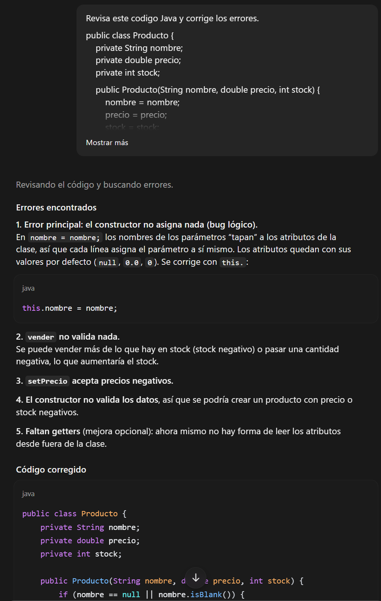
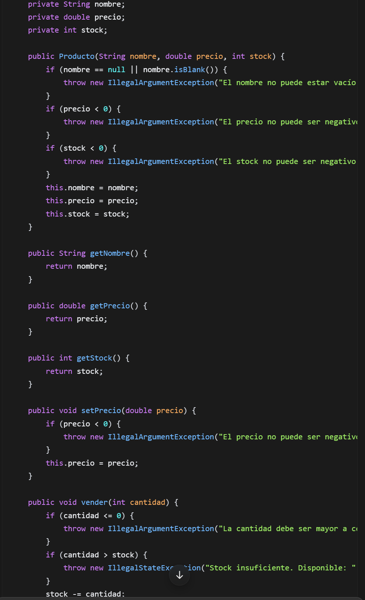

# Tarea: Mi prompt avanzado

## Tarea elegida

Detectar y corregir errores en una clase Java Producto.

## Version 1: prompt basico
### Prompt utilizado

Revisa este codigo Java y corrige los errores.

### Codigo Java utilizado

```java
public class Producto {
    private String nombre;
    private double precio;
    private int stock;

    public Producto(String nombre, double precio, int stock) {
        nombre = nombre;
        precio = precio;
        stock = stock;
    }

    public void setPrecio(double precio) {
        this.precio = precio;
    }

    public void vender(int cantidad) {
        stock = stock - cantidad;
    }

    public void mostrarProducto() {
        System.out.println(nombre + " - S/ " + precio + " - Stock: " + stock);
    }
}
```

### Evidencia de la Version 1





### Resultado de Claude

Claude identifico cuatro problemas principales:

1. El constructor asignaba los parametros a si mismos en lugar de inicializar los atributos.
2. El metodo vender no validaba cantidades negativas, cero o superiores al stock disponible.
3. El metodo setPrecio permitia precios negativos.
4. El constructor no validaba datos como nombre vacio, precio negativo o stock negativo.

Tambien propuso agregar getters como mejora opcional.

### Observaciones

Claude detecto los problemas principales y genero una version corregida de la clase Producto. Aunque el prompt era basico, presento una lista de errores y explicaciones.

No se solicito un formato especifico ni una comprobacion de compilacion. El codigo corregido todavia no ha sido probado mediante ejecucion.


## Version 2


## Version 3: prompt final

## Tecnicas usadas en el prompt final

## Evaluacion del resultado

## Por que elegi estas tecnicas